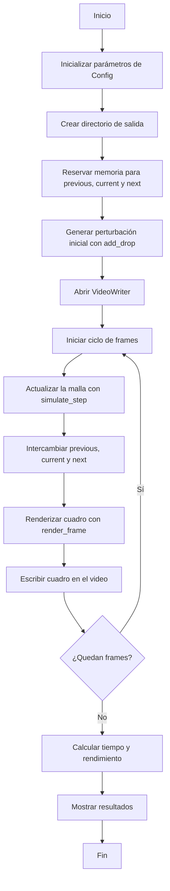

# Laboratorio Capítulo 3

## Integrantes, curso y profesor

### Integrantes

1. Fiorela Chavarría Castrillo
2. Fabián Parreaguirre Hidalgo
3. Brayan Rodríguez Villalobos

### Curso

Introducción a la Computación Heterogénea - EL-5859

### Profesor

Dr. Luis G. León-Vega

### Características del sistema

Todo se compiló y midió en la Jetson Nano.

| | |
|---|---|
| Equipo | Jetson Nano (GPU Maxwell, `sm_53`) |
| Sistema | Ubuntu 18.04.6 LTS, kernel 4.9.253-tegra, aarch64 |
| Herramientas | gcc 7.5.0, nvcc, meson 0.45.1, ninja 1.8.2 |
| CUDA y OpenCV | _pendiente_ |
| Perfilado CPU | `std::chrono` y Google Performance Tools |
| Perfilado GPU | nvprof |


## Programa base

Simula la caída de una gota sobre un estanque con una ecuación de onda 2D amortiguada (C++ y OpenCV) y genera un video en escala de grises. Cada celda guarda la altura del agua y se actualiza con un stencil de 5 puntos:

```text
laplaciano = izquierda + derecha + arriba + abajo - 4 * centro

h_next = 2 * h_current - h_previous
         + c^2 * dt^2 * laplaciano
         - damping * (h_current - h_previous)
```

Para el video se calculan normales con diferencias finitas y se aplica iluminación simple. Parámetros: malla de 640x640, 30 s a 30 fps (900 pasos), `wave_speed` 0.45, `damping` 0.006, `edge_damping` 0.035, `drop_radius` 18 y `drop_strength` 1.0.

## Ejercicio A - Ejecución de la versión CPU (Fiorela)

Los comandos se ejecutan desde `ejercicioA/`.

En la Jetson no se contaba con `meson` ni `ninja` instalados de forma global y no se tenían permisos `sudo`. Para poder compilar el proyecto, ambos paquetes se descargaron mediante `apt download` y se extrajeron localmente dentro de `~/local-tools`.

Posteriormente, se agregaron las rutas de los ejecutables al `PATH`, permitiendo utilizar los comandos `meson` y `ninja` desde la terminal sin realizar una instalación a nivel del sistema.

Debido a que la versión disponible de Meson era 0.45.1, el comando:

    meson compile -C build

no estaba disponible. Por esta razón, la configuración del proyecto se realizó con:

    meson setup build

y la compilación se ejecutó directamente con Ninja:

    ninja -C build

Durante la compilación también fue necesario realizar un ajuste de compatibilidad en el código, ya que el entorno utilizaba `g++ 7.5.0` y la implementación original empleaba `std::filesystem`.

La creación del directorio de salida se reemplazó por el uso de `mkdir()`, sin modificar el funcionamiento de la simulación.

### Resultados del ejercicio A:

| Métrica | Resultado |
|---|---:|
| Tiempo total | 111.632 s |
| Pasos simulados | 900 |
| Rendimiento | 8.06219 pasos/s |
| Resolución | 640 x 640 |
| FPS | 30 |
| Duración del video | 30 s |

## Ejercicio A (Brayan)

``` bash
cd ejercicioA
meson setup build
```
Tal como se indica en las instrucciones se intenta ejecutar `meson setup -C` lo cual retorna un error. En su lugar se ejecuta:

``` bash 
ninja -C build
```
Esto retorna el siguiente error:

``` bash
ninja: Entering directory `build'
[1/2] Compiling C++ object 'drop_simulation@exe/src_main.cpp.o'.
FAILED: drop_simulation@exe/src_main.cpp.o
c++  -Idrop_simulation@exe -I. -I.. -I/usr/include/opencv4/opencv -I/usr/include/opencv4 -fdiagnostics-color=always -pipe -D_FILE_OFFSET_BITS=64 -Wall -Winvalid-pch -Wnon-virtual-dtor -Wextra -Wpedantic -std=c++17 -O3 -MD -MQ 'drop_simulation@exe/src_main.cpp.o' -MF 'drop_simulation@exe/src_main.cpp.o.d' -o 'drop_simulation@exe/src_main.cpp.o' -c ../src/main.cpp
../src/main.cpp:4:10: fatal error: filesystem: No such file or directory
 #include <filesystem>
          ^~~~~~~~~~~~
compilation terminated.
ninja: build stopped: subcommand failed.
```

Por lo que se realizan cambios en el programa para poder ejecutarlo, específicamente los problemas relacionados a las versiones de c++ soportadas por la plataforma Jetson Nano.

Después de ejecutar el programa se obtiene el siguiente resultado:

``` bash
Frame 0 / 60
Frame 6 / 60
Frame 12 / 60
Frame 18 / 60
Frame 24 / 60
Frame 30 / 60
Frame 36 / 60
Frame 42 / 60
Frame 48 / 60
Frame 54 / 60
Tiempo simulate_step: 0.391052 s
Tiempo render_frame: 5.07178 s
Tiempo writer.write: 1.04145 s
Porcentaje simulate_step: 6.01111 %
Porcentaje render_frame: 77.9616 %
Porcentaje writer.write: 16.0088 %
Video generado: output/drop_simulation.mp4
Tiempo: 6.50548 s
Pasos simulados: 60
Rendimiento: 9.22299 pasos/s
```

## Ejercicio B - Comprensión del código

El archivo `ejercicioB/main_comentado.cpp` se comentó para explicar las funciones de la simulación.

Lo que simula el programa es la caída de una gota sobre una superficie de agua. Primero se hace una perturbación en el centro de una malla y luego se calcula cómo esa pertubación se propaga hacia los demás puntos. La altura de la malla se va actualizando en cada paso y luego se genera una imagen, la cual se incorpora al video.

El modelo sería una aproximación de una onda bidimensional amortiguada. Cada punto se calcularía tomando en cuenta los vecinos y los estados anteriores, mientras que el amortiguamiento haría que la onda vaya perdiendo energía y disminuyendo las reflexiones en los bordes.

### Diagrama de flujo



## Ejercicio C - Perfilado CPU (Fiorela)

Para identificar las funciones con mayor costo computacional se utilizaron dos métodos:

- Instrumentación manual con `std::chrono`.
- Google Performance Tools (`gperftools`).

### Resultados con `std::chrono`

| Sección | Tiempo | Porcentaje |
|---|---:|---:|
| `simulate_step()` | 5.80552 s | 5.22 % |
| `render_frame()` | 86.5335 s | 77.86 % |
| `writer.write()` | 18.7897 s | 16.91 % |

Los resultados muestran que `render_frame()` concentra la mayor parte del tiempo de ejecución medido.

### Resultados con Google Performance Tools

El perfil obtenido con `gperftools` registró 10627 muestras. La función `render_frame()` concentró aproximadamente 47.8 % de las muestras directas de CPU, siendo la función propia del programa con mayor presencia en el perfil.

Los resultados completos se encuentran en:

```text
ejercicioC/profiling_gperftools.txt
```

Los resultados obtenidos mediante temporizadores se almacenan en:

```text
ejercicioC/profiling_chrono.txt
```

### Análisis del perfilado

Según los resultados, `render_frame()` se puede identificar como la función con mayor costo computacional, por lo que se puede considerar como la primera candidata para ser portada a GPU. Por otro lado, `writer.write()` no se considera una función para portar directamente a un kernel CUDA, ya que corresponde principalmente al proceso de codificación y escritura del video.

### Herramientas alternativas

Durante el perfilado se encontraron limitaciones con algunas herramientas en el entorno. `perf` no se encontraba disponible y Valgrind/Callgrind no pudo completar la ejecución debido al consumo de memoria. Debido a esto, se utilizaron `std::chrono` y Google Performance Tools como alternativas para realizar el perfilado de CPU.

### Para la ejecución de Google Performance Tools

Desde `ejercicioA/`, después de compilar:

    CPUPROFILE=cpu_profile.prof \
    LD_PRELOAD="$HOME/local-tools/libgoogle-perftools4/usr/lib/aarch64-linux-gnu/libprofiler.so.0.4.8" \
    ./build/drop_simulation

    ~/local-tools/google-perftools/usr/bin/google-pprof \
    --text \
    ./build/drop_simulation \
    cpu_profile.prof > ../ejercicioC/profiling_gperftools.txt

## Ejercicio C (Brayan)

Para realizar el perfilado del programa se utilizaron dos estrategias distintas: Instrumentación manual con temporizadores y Google Performance Tools. Algunos de los motivos por los que se eligieron estas dos, es porque `perf` no estaba disponible y porque callgrind demostró tardar bastante tiempo.

### Instrumentación manual con temporizadores

Utilizando la biblioteca std::chronos se realizaron mediciones de tiempo en la ejecución del programa y se obtuvieron los siguientes datos:

``` bash
Tiempo simulate_step: 0.391052 s
Tiempo render_frame: 5.07178 s
Tiempo writer.write: 1.04145 s
Porcentaje simulate_step: 6.01111 %
Porcentaje render_frame: 77.9616 %
Porcentaje writer.write: 16.0088 %
Video generado: output/drop_simulation.mp4
Tiempo: 6.50548 s
Pasos simulados: 60
Rendimiento: 9.22299 pasos/s
```


### Google Performance Tools

Se ejecutaron los siguientes comandos para utilizar la herramienta:

```bash 
 cd ejercicioC
 meson setup build && ninja -C build

 CPUPROFILE=cpu_profile.prof LD_PRELOAD="/home/el5859/local-tools/libgoogle-perftools4/usr/lib/aarch64-linux-gnu/libprofiler.so.0.4.8" ./build/drop_simulation

 ~/local-tools/google-perftools/usr/bin/google-pprof --text ./build/drop_simulation ./cpu_profile.prof > cpu_profiling_gperftools.txt

```

Lo que da como resultado:

``` bash

Total: 658 samples
     302  45.9%  45.9%      304  46.2% main
     153  23.3%  69.1%      153  23.3% vrndn_f64 (inline)
      40   6.1%  75.2%      237  36.0% __powf
      35   5.3%  80.5%       35   5.3% av_jni_get_java_vm
      30   4.6%  85.1%       30   4.6% log2_inline (inline)
      25   3.8%  88.9%       28   4.3% avpriv_mpa_decode_header
      18   2.7%  91.6%       18   2.7% sws_get_class
      16   2.4%  94.1%       16   2.4% av_parser_close
      14   2.1%  96.2%      167  25.4% exp2_inline (inline)
       4   0.6%  96.8%        4   0.6% _init
       4   0.6%  97.4%        4   0.6% avpriv_aac_parse_header
       3   0.5%  97.9%        3   0.5% __GI_memset
       3   0.5%  98.3%        3   0.5% av_picture_pad
       2   0.3%  98.6%        2   0.3% __memcpy_generic
       2   0.3%  98.9%        2   0.3% av_mediacodec_release_buffer
       2   0.3%  99.2%        2   0.3% avpriv_copy_pce_data
       1   0.2%  99.4%        1   0.2% __GI___expf
       1   0.2%  99.5%        1   0.2% av_dct_end
       1   0.2%  99.7%        1   0.2% av_picture_copy
       1   0.2%  99.8%        1   0.2% avcodec_default_get_buffer2
       1   0.2% 100.0%        1   0.2% avpriv_fits_header_parse_line
       0   0.0% 100.0%      304  46.2% __libc_start_main
       0   0.0% 100.0%      304  46.2% _start
       0   0.0% 100.0%      153  23.3% roundtoint (inline)

```

## Ejercicio D

## Ejercicio E

## Ejercicio F

Se hicieron cuatro optimizaciones sobre la versión GPU, la idea fue hacer cada una sobre la anterior. Pero todas parten del perfilado: el de CPU del ejercicio C (`render_frame()` con 78 % del tiempo, `writer.write()` con 17 % y `__powf` como lo más pesado dentro del render) y el nvprof de la versión base. El código está en `ejercicioF/src/`:


A manera de resumen así se ve esta carpeta:


| Versión | Archivo | Qué cambia |
|---|---|---|
| GPU base | `v0_base.cu` | Es `ported.cu` (`ejercicioD/`) con temporizadores y `--validate`. Los kernels no cambian. |
| Optimización 1 | `v1_menos_datos.cu` | El render escribe 1 byte por píxel en vez de 3 y se quita la sincronización de cada paso. |
| Optimización 2 | `v2_shared_memory.cu` | Bloques de 32x8 y memoria compartida para los vecinos. |
| Optimización 3 | `v3_aritmetica.cu` | `powf(x, 24)` se cambia por multiplicaciones. |
| Optimización 4 | `v4_async.cu` | Stream propio, copia asíncrona y doble buffer. |

`common.h` tiene lo que comparten todas: configuración, referencia en CPU, temporizadores y validación.

```bash
cd ejercicioF
meson setup build
ninja -C build
./build/drop_simulation_v4_async              # genera output/v4_async.mp4
./build/drop_simulation_v4_async --validate   # compara contra la CPU
./run_benchmarks.sh                           # corre todo y arma results/tabla.md
```

Los kernels y la copia se midieron con `cudaEvent` y con nvprof. El video, con `std::chrono`.

El video que genera la versión final (30 s) está en `ejercicioF/video/v4_async.mp4`.

### Optimización 1: menos datos al host

- Problema: Basicamente los tres canales del cuadro son iguales, pero se copiaban 1.2 MB por cuadro. Además había un `cudaDeviceSynchronize` después de cada paso.
- Cambio: el kernel de render escribe un solo canal, se quita el `cudaDeviceSynchronize` y el CPU pasa el gris a BGR con `cv::cvtColor` antes de escribir al video.
- Evidencia: en nvprof de la base la copia DtoH tarda 123 µs por cuadro, el 10 % del tiempo de GPU.
- Resultado: la copia baja a 42 µs y el total pasa de 14.34 s a 14.08 s (es decir una mejora de 1.02x o 2% menos).
- Precisión: sin cambio.

### Optimización 2: memoria compartida

- Problema: el stencil lee cada altura cinco veces de memoria global.
- Cambio: bloques de 32x8 y un `tile` en memoria compartida que cada bloque llena una sola vez.

```cpp
__shared__ float tile[kTileH][kTileW];
load_tile(current, tile, width, height, x0, y0);
__syncthreads();

const float laplacian = tile[ty][tx - 1] + tile[ty][tx + 1] +
                        tile[ty - 1][tx] + tile[ty + 1][tx] - 4.0f * center;
```

- Evidencia: el perfil de CPU (ejercicio C) marcó el render y la simulación como lo más pesado, y los dos leen cinco vecinos. En nvprof de la versión 1 tardan 446 µs y 639 µs por cuadro.
- Resultado: empeoró. La simulación sube a 612 µs y el render a 777 µs, y el total pasa de 14.08 s a 14.28 s (0.99x). Posiblemente la situación aqui fue que llenar el tile cuesta más de lo que se ahorra por lo que termina no valiendo la pena.
- Precisión: sin cambio.

### Optimización 3: aritmética del render

- Problema: el render calcula `powf(diffuse, 24.0f)` en cada píxel.
- Cambio: como el exponente es un entero constante, se calcula con multiplicaciones.

```cpp
// x^24 = x^16 * x^8
__device__ float pow24(float x) {
    const float x2 = x * x;
    const float x4 = x2 * x2;
    const float x8 = x4 * x4;
    const float x16 = x8 * x8;
    return x16 * x8;
}
```

- Evidencia: en el perfil de CPU del ejercicio C `__powf` (con `exp2` y `log2`) sumaba 31 % de las muestras de gperftools en el perfil de Fiorela y 36 % en el de Brayan. En nvprof el render es el kernel más largo (667 µs, 54 % del tiempo de GPU).
- Resultado: el render baja de 777 µs a 520 µs y el total de 14.28 s a 14.04 s (Mejora de 1.02x).
- Precisión: el error en píxeles sigue en 1 de 255. No se usó `-use_fast_math` porque con este cambio ya casi no quedan funciones especiales en el kernel.

### Optimización 4: streams y doble buffer

- Problema: la GPU y la CPU se esperaban una a la otra. Cada cuadro se simulaba y copiaba, y solo después se codificaba.
- Cambio: todo el trabajo de GPU va en un stream, la copia es `cudaMemcpyAsync` a memoria pinned y hay dos buffers en el host. Mientras la CPU codifica el cuadro N, la GPU ya hace el N+1.

```text
v3  GPU: [cuadro N]            [cuadro N+1]
    CPU:           [codificar N]             [codificar N+1]

v4  GPU: [cuadro N+1]          [cuadro N+2]
    CPU: [codificar N ......]  [codificar N+1 ......]
```

- Evidencia: en el ejercicio C `writer.write()` ya tenía 17 % del tiempo y no se podía portar a GPU. Con lo demás en GPU pasa a ser lo que más pesa: 12.5 s de los 14.0 s de la versión 3, contra solo 1.2 ms por cuadro de kernels y copia.
- Resultado: el total baja de 14.04 s a 13.37 s (1.05x). La espera por la GPU suma solo 0.004 s. El tiempo de `writer.write` sube 0.5 s, quizás porque CPU y GPU comparten la misma RAM.
- Precisión: sin cambio.

## Ejercicio G

Todo se midió en la Jetson Nano con el video completo (30 s, 900 pasos), con `sudo nvpmodel -m 0` y `sudo jetson_clocks`. Los tiempos son la mediana de 5 corridas y salen de `ejercicioF/results/tabla.md`.

```bash
sudo nvpmodel -m 0
sudo jetson_clocks
sudo env REPS=5 ./run_benchmarks.sh
```

| Versión | Tiempo total (s) | Pasos/s | Speedup vs CPU | Speedup vs anterior | Error máximo |
|---|---:|---:|---:|---:|---:|
| CPU base | 71.54 | 12.58 | 1.00x | - | 0 |
| GPU base | 14.34 | 62.77 | 4.99x | - | 0 |
| Optimización 1 | 14.08 | 63.94 | 5.08x | 1.02x | 0 |
| Optimización 2 | 14.28 | 63.02 | 5.01x | 0.99x | 0 |
| Optimización 3 | 14.04 | 64.09 | 5.09x | 1.02x | 0 |
| Optimización 4 | 13.37 | 67.31 | 5.35x | 1.05x | 0 |

El error máximo es la mayor diferencia en la malla de alturas contra la CPU después de 900 pasos (`--validate`). En píxeles el máximo es 1 de 255 en todas las versiones. Las salidas están en `ejercicioF/results/*_validacion.txt`.

Tiempo por llamada según nvprof (µs):

| Versión | Simulación | Render | Copia D2H |
|---|---:|---:|---:|
| GPU base | 429 | 667 | 123 |
| Optimización 1 | 446 | 639 | 42 |
| Optimización 2 | 612 | 777 | 42 |
| Optimización 3 | 613 | 520 | 42 |
| Optimización 4 | 618 | 530 | 44 |

La copia de host a device pasa una sola vez al inicio y tarda menos de 1 ms. Salidas de nvprof de la base y de la versión final (`ejercicioF/results/*_nvprof.txt`):

```text
GPU base
 GPU activities:   54.48%  100.04ms  150  666.91us  render_frame_kernel(...)
                   35.01%  64.290ms  150  428.60us  simulate_step_kernel(...)
                   10.04%  18.436ms  150  122.91us  [CUDA memcpy DtoH]

Optimización 4
 GPU activities:   51.63%  92.686ms  150  617.90us  simulate_step_kernel(...)
                   44.29%  79.515ms  150  530.10us  render_frame_kernel(...)
                    3.70%  6.6415ms  150  44.276us  [CUDA memcpy DtoH]
```

### Análisis

- Casi todo el tiempo es codificar el video. En el ejercicio C `writer.write()` era el 17 % del tiempo en CPU, y con lo demás en GPU pasa a ser el 86 % (12.3 s de los 14.3 s de la base). La GPU (kernels y copia) son solo unos 1.2 ms por cuadro, por eso las optimizaciones de GPU mejoran poco el total.
- La Optimización 3 fue la que más bajó un kernel (el render, 33 %) y la 4 la que más bajó el total.
- La Optimización 2 empeoró los dos kernels.

### Lectura previa

- Acceso a memoria: el stencil reutiliza cada valor cinco veces, pero usar memoria compartida no ayudó porque llenar el tile costó más de lo que ahorró.
- Precisión y velocidad: todo se mantiene en `float32` y el cambio de aritmética no movió el error.
- Comunicación host-device: las optimizaciones 1 y 4 no cambian lo que calcula ningún kernel, solo cuántos datos se mueven y cuándo, y aun así cambian el tiempo total.

### Conclusiones

El perfilado del ejercicio C marcó qué portar (`render_frame()` y `simulate_step()`) y de dónde salieron la optimización 3 (`__powf`) y la 4 (`writer.write()`). La versión final es 5.35x más rápida que la CPU (71.5 s a 13.4 s). Casi todo ese salto viene de pasar la simulación y el render a GPU; las cuatro optimizaciones sumaron un 7 % más. La aritmética del render y los streams ayudaron, la memoria compartida no. Lo que falta por mejorar es la codificación del video, que sigue en la CPU y es precisamente lo que más aportaria a optimizar el código, esto se podría hacer, por ejemplo, con el codificador por hardware de la Jetson.

---

## Reconocimiento

Como método de transparencia, se reporta el uso de herramientas de Inteligencia Artificial como apoyo durante el desarrollo, prueba, análisis y documentación del presente laboratorio.

[Conversación 1](https://chatgpt.com/share/6acc2290-b1e8-83e8-b0b2-0d14620fe590)

[Conversación 2](https://claude.ai/share/251aa86f-f2b4-4041-9438-c7fdb5a50409)
