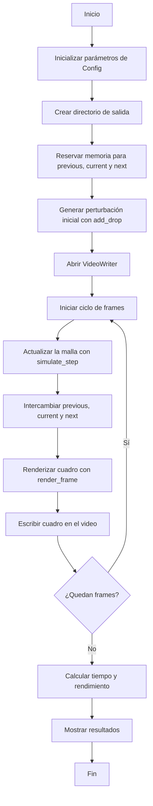

# Laboratorio 5 - GPU/CUDA

## Integrantes

1. Fiorela Chavarría Castrillo
2. Fabián Parreaguirre Hidalgo
3. Brayan Rodríguez Villalobos

## Curso

Introducción a la Computación Heterogénea - EL-5859

## Profesor

Dr. Luis G. León-Vega

---

# Drop Simulation

Prototipo CPU en C++ y OpenCV para simular la caida de una gota sobre un estanque
usando una ecuacion de onda 2D amortiguada.

El objetivo es que esta version sea la referencia inicial del laboratorio antes de
portar el calculo principal a GPU y aplicar optimizaciones como coalescing,
shared memory, matematica aproximada y precision de 16 bits.

## Compilar

```bash
meson setup build
meson compile -C build
```

## Ejecutar

```bash
./build/drop_simulation
```

Por defecto genera:

```text
output/drop_simulation.mp4
```

## Parametros actuales

```text
width             640
height            640
seconds           30
fps               30
steps_per_frame   1
wave_speed        0.45
damping           0.006
edge_damping      0.035
drop_radius       18
drop_strength     1.0
output            output/drop_simulation.mp4
```

Estos valores estan definidos en `src/main.cpp`, dentro de `Config`.

## Idea fisica

Cada celda guarda la altura de la superficie del agua. La actualizacion usa un
stencil de 5 puntos:

```text
laplaciano = izquierda + derecha + arriba + abajo - 4 * centro

h_next = 2 * h_current - h_previous
         + c^2 * dt^2 * laplaciano
         - damping * (h_current - h_previous)
```

Para visualizar, se calculan normales aproximadas con diferencias finitas y se
aplica iluminacion simple. Esto produce un efecto de agua sin requerir un motor
3D.
---

## Ejercicio A - Ejecución de la versión CPU

En la Jetson no se contaba con `meson` ni `ninja` instalados de forma global y no se tenían permisos `sudo`. Para poder compilar el proyecto, ambos paquetes se descargaron mediante `apt download` y se extrajeron localmente dentro de `~/local-tools`.

Posteriormente, se agregaron las rutas de los ejecutables al `PATH`, permitiendo utilizar los comandos `meson` y `ninja` desde la terminal sin realizar una instalación a nivel del sistema.

Debido a que la versión disponible de Meson era 0.45.1, el comando:

    meson compile -C build

no estaba disponible. Por esta razón, la configuración del proyecto se realizó con:

    meson setup build

y la compilación se ejecutó directamente con Ninja:

    ninja -C build

Durante la compilación también fue necesario realizar un ajuste de compatibilidad en el código, ya que el entorno utilizaba `g++ 7.5.0` y la implementación original empleaba `std::filesystem`.

La creación del directorio de salida se reemplazó por el uso de `mkdir()`, sin modificar el funcionamiento de la simulación.

### Resultados del ejercicio A:

| Métrica | Resultado |
|---|---:|
| Tiempo total | 111.632 s |
| Pasos simulados | 900 |
| Rendimiento | 8.06219 pasos/s |
| Resolución | 640 x 640 |
| FPS | 30 |
| Duración del video | 30 s |

## Ejercicio B - Comprensión del código

El archivo `src/main.cpp` se comentó para explicar las funciones de la simulación.

Lo que simula el programa es la caída de una gota sobre una superficie de agua. Primero se hace una perturbación en el centro de una malla y luego se calcula cómo esa pertubación se propaga hacia los demás puntos. La altura de la malla se va actualizando en cada paso y luego se genera una imagen, la cual se incorpora al video.

El modelo sería una aproximación de una onda bidimensional amortiguada. Cada punto se calcularía tomando en cuenta los vecinos y los estados anteriores, mientras que el amortiguamiento haría que la onda vaya perdiendo energía y disminuyendo las reflexiones en los bordes.

### Diagrama de flujo



## Ejercicio C - Perfilado CPU

Para identificar las funciones con mayor costo computacional se utilizaron dos métodos:

- Instrumentación manual con `std::chrono`.
- Google Performance Tools (`gperftools`).

### Resultados con `std::chrono`

| Sección | Tiempo | Porcentaje |
|---|---:|---:|
| `simulate_step()` | 5.80552 s | 5.22 % |
| `render_frame()` | 86.5335 s | 77.86 % |
| `writer.write()` | 18.7897 s | 16.91 % |

Los resultados muestran que `render_frame()` concentra la mayor parte del tiempo de ejecución medido.

### Resultados con Google Performance Tools

El perfil obtenido con `gperftools` registró 10627 muestras. La función `render_frame()` concentró aproximadamente 47.8 % de las muestras directas de CPU, siendo la función propia del programa con mayor presencia en el perfil.

Los resultados completos se encuentran en:

```text
profiling_gperftools.txt
```

Los resultados obtenidos mediante temporizadores se almacenan en:

```text
profiling_chrono.txt
```

### Análisis del perfilado

Según los resultados, `render_frame()` se puede identificar como la función con mayor costo computacional, por lo que se puede considerar como la primera candidata para ser portada a GPU. Por otro lado, `writer.write()` no se considera una función para portar directamente a un kernel CUDA, ya que corresponde principalmente al proceso de codificación y escritura del video.

### Herramientas alternativas

Durante el perfilado se encontraron limitaciones con algunas herramientas en el entorno. `perf` no se encontraba disponible y Valgrind/Callgrind no pudo completar la ejecución debido al consumo de memoria. Debido a esto, se utilizaron `std::chrono` y Google Performance Tools como alternativas para realizar el perfilado de CPU.

### Para la ejecución de Google Performance Tools

    CPUPROFILE=cpu_profile.prof \
    LD_PRELOAD="$HOME/local-tools/libgoogle-perftools4/usr/lib/aarch64-linux-gnu/libprofiler.so.0.4.8" \
    ./build/drop_simulation

    ~/local-tools/google-perftools/usr/bin/google-pprof \
    --text \
    ./build/drop_simulation \
    cpu_profile.prof > profiling_gperftools.txt

---

## Reconocimiento

Como método de transparencia, se reporta el uso de herramientas de Inteligencia Artificial como apoyo durante el desarrollo, prueba, análisis y documentación del presente laboratorio.

[Conversación 1](https://chatgpt.com/share/6acc2290-b1e8-83e8-b0b2-0d14620fe590)